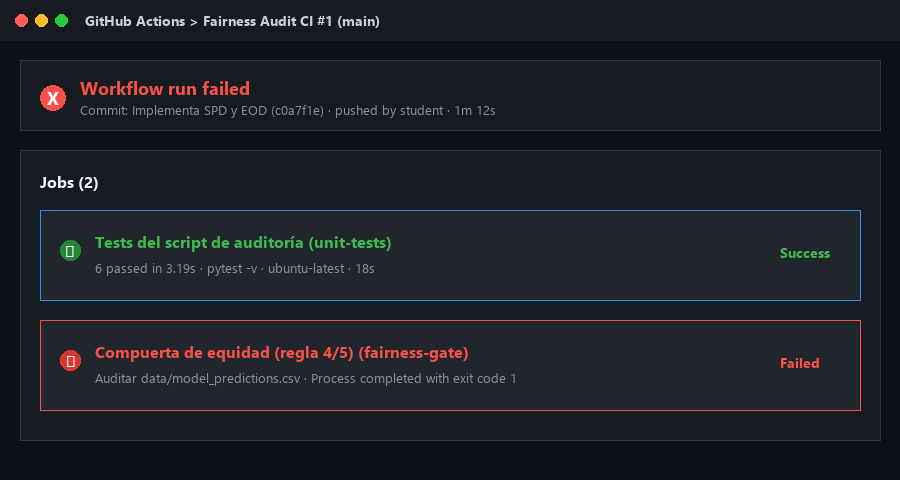
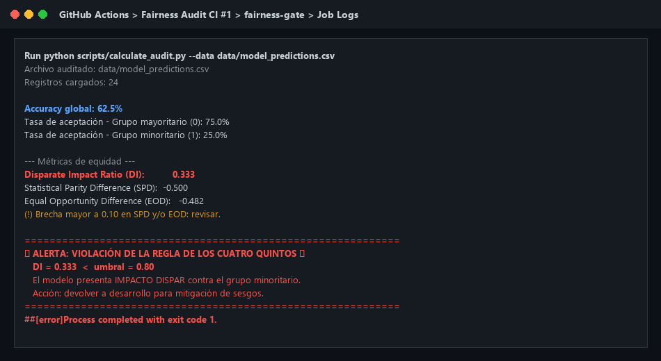
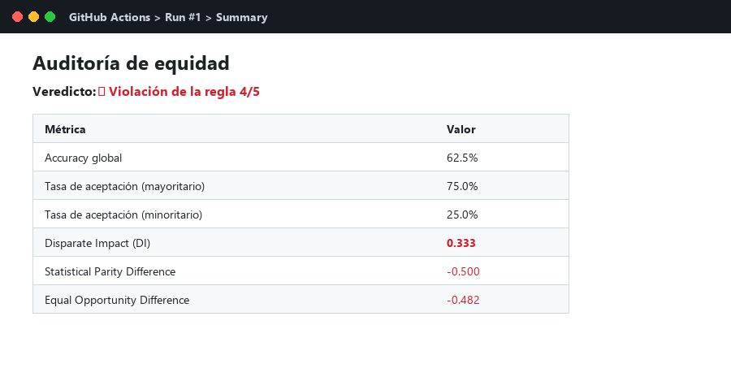
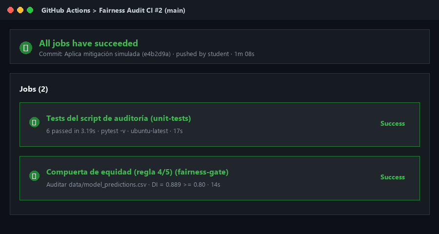
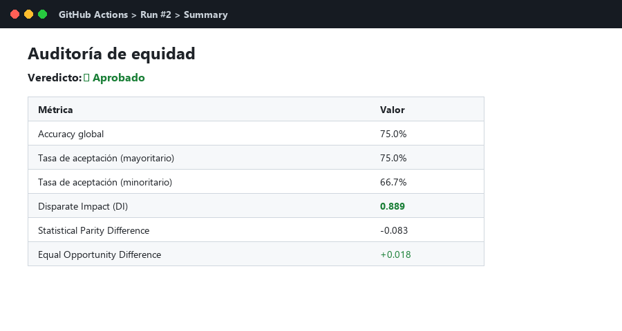

# Taller: Auditoría de Sesgo y Documentación de Modelos de IA

[](https://github.com/fajardojuan402-pixel/TallerEtica/actions/workflows/fairness-audit.yml)

Taller práctico de 30 minutos. **No se entrena ningún modelo**: se audita uno ya
existente a partir de sus predicciones, se integra la auditoría en CI y se
documentan los resultados en una Model Card.

## 🎯 Objetivo

Al finalizar el taller serás capaz de:

1. Calcular métricas de equidad (**Disparate Impact**, **Statistical Parity Difference**,
   **Equal Opportunity Difference**) a partir de un CSV de predicciones.
2. Aplicar la **regla de los cuatro quintos** (DI ≥ 0.80) como criterio de aprobación.
3. Usar la auditoría como **quality gate en CI/CD** con GitHub Actions.
4. Documentar los hallazgos en una **Model Card**.

## 📁 Estructura

```
├── .github/workflows/fairness-audit.yml   # CI (no modificar)
├── data/model_predictions.csv             # Dataset a auditar
├── scripts/calculate_audit.py             # Script con 2 TODO por implementar
├── tests/                                 # Tests del script + datasets de referencia
├── MODEL_CARD_TEMPLATE.md                 # Plantilla de la Model Card
└── docs/img/                              # Aquí van tus capturas
```

## 🚀 Cómo empezar

Cada estudiante trabaja en **su propio repositorio público**, porque el CI de GitHub Actions
se ejecuta ahí. Clonar el repositorio del taller no basta: tu `git push` debe ir a tu repo, no al del docente.

### 1. Crea tu repositorio vacío en GitHub

1. Entra a <https://github.com/new>.
2. Nómbralo, por ejemplo, `bias-audit-workshop`.
3. Selecciona visibilidad **Public**.
4. **No marques** "Add a README", ".gitignore" ni "license". El repo debe quedar vacío.
5. Pulsa **Create repository**.

### 2. Clona el taller y apunta al repo que creaste

```bash
git clone https://github.com/<USUARIO_DOCENTE>/<REPO_DEL_TALLER>.git bias-audit-workshop
cd bias-audit-workshop

git remote set-url origin https://github.com/<TU_USUARIO>/<TU_REPO>.git
git branch -M main
git push -u origin main
```

Verifica que apuntas a tu repo y no al del docente:

```bash
git remote -v      # debe mostrar TU usuario, no el del docente
```

### 3. Comprueba que el CI está activo

1. Abre la pestaña **Actions** de tu repositorio.
2. Debe aparecer un run de **Fairness Audit CI** disparado por tu primer push.
3. Si ves un botón verde _"I understand my workflows, go ahead and enable them"_, púlsalo y relanza con **Run workflow**.

> Este primer run es **esperado**: `unit-tests` ✅ (con 2 tests _skipped_) y
> `fairness-gate` ❌. El modelo es sesgado a propósito; no es un error tuyo.

### 4. Actualiza el badge

Reemplaza `<USUARIO>/<REPO>` en la primera línea de este README por los tuyos.

### 5. Instala las dependencias (Python 3.9+)

```bash
python -m venv .venv
source .venv/bin/activate          # Windows: .venv\Scripts\activate
pip install -r requirements-dev.txt
```

## ▶️ Ejecución

```bash
python scripts/calculate_audit.py                    # audita data/model_predictions.csv
python scripts/calculate_audit.py --data <otro.csv>  # audita otro archivo
pytest -v                                            # tests del script
echo $?                                              # 0 = aprueba, 1 = viola la regla 4/5
```

---

## 📝 Pasos del taller

### Paso 1. Ejecuta el script tal como está

Corre el script sin modificar nada. Las métricas SPD y EOD deben aparecer como `PENDIENTE`.

**Evidencia 1: salida en consola (TODOs pendientes):**

```
Archivo auditado: C:\Users\david\Desktop\TallerEtica\data\model_predictions.csv
Registros cargados: 24

Accuracy global: 62.5%
Tasa de aceptación - Grupo mayoritario (0): 75.0%
Tasa de aceptación - Grupo minoritario (1): 25.0%

Matriz de confusión - Grupo Mayoritario (0):
   TN=2  FP=3  FN=1  TP=6
   TPR (Recall) = 85.7%   FPR = 60.0%

Matriz de confusión - Grupo Minoritario (1):
   TN=4  FP=0  FN=5  TP=3
   TPR (Recall) = 37.5%   FPR = 0.0%

--- Métricas de equidad ---
Disparate Impact Ratio (DI):          0.333
Statistical Parity Difference (SPD):  PENDIENTE (TODO 2)
Equal Opportunity Difference (EOD):   PENDIENTE (TODO 1)

============================================================
🚨 ALERTA: VIOLACIÓN DE LA REGLA DE LOS CUATRO QUINTOS 🚨
   DI = 0.333  <  umbral = 0.80
   El modelo presenta IMPACTO DISPAR contra el grupo minoritario.
   Acción: devolver a desarrollo para mitigación de sesgos.
============================================================
```

### Paso 2. Implementa los TODO

En `scripts/calculate_audit.py` implementa:

- **TODO 1**: `equal_opportunity_difference` (TPR_min − TPR_maj)
- **TODO 2**: `statistical_parity_difference` (rate_min − rate_maj)

Verifica con `pytest -v`: los tests de SPD y EOD deben pasar de _skipped_ a _passed_.

**Evidencia 2: salida de `pytest -v` con TODOs implementados:**

```
============================= test session starts =============================
platform win32 -- Python 3.14.0, pytest-8.4.2, pluggy-1.6.0 -- C:\Users\david\AppData\Local\Programs\Python\Python314\python.exe
cachedir: .pytest_cache
rootdir: C:\Users\david\Desktop\TallerEtica
plugins: anyio-4.13.0
collecting ... collected 6 items

tests/test_audit.py::test_selection_rates_biased PASSED                  [ 16%]
tests/test_audit.py::test_disparate_impact_biased PASSED                 [ 33%]
tests/test_audit.py::test_spd_and_eod_biased PASSED                      [ 50%]
tests/test_audit.py::test_zero_majority_rate_raises PASSED               [ 66%]
tests/test_audit.py::test_exit_code_is_1_for_biased_model PASSED         [ 83%]
tests/test_audit.py::test_exit_code_is_0_for_fair_model PASSED           [100%]

============================== 6 passed in 3.19s ==============================
```

**Evidencia 3: salida en consola sobre el dataset sesgado (TODOs implementados):**

```
Archivo auditado: C:\Users\david\Desktop\TallerEtica\data\model_predictions.csv
Registros cargados: 24

Accuracy global: 62.5%
Tasa de aceptación - Grupo mayoritario (0): 75.0%
Tasa de aceptación - Grupo minoritario (1): 25.0%

Matriz de confusión - Grupo Mayoritario (0):
   TN=2  FP=3  FN=1  TP=6
   TPR (Recall) = 85.7%   FPR = 60.0%

Matriz de confusión - Grupo Minoritario (1):
   TN=4  FP=0  FN=5  TP=3
   TPR (Recall) = 37.5%   FPR = 0.0%

--- Métricas de equidad ---
Disparate Impact Ratio (DI):          0.333
Statistical Parity Difference (SPD):  -0.500
Equal Opportunity Difference (EOD):   -0.482
(!) Brecha mayor a 0.10 en SPD y/o EOD: revisar. Estas dos métricas son informativas; la compuerta usa solo el DI.

============================================================
🚨 ALERTA: VIOLACIÓN DE LA REGLA DE LOS CUATRO QUINTOS 🚨
   DI = 0.333  <  umbral = 0.80
   El modelo presenta IMPACTO DISPAR contra el grupo minoritario.
   Acción: devolver a desarrollo para mitigación de sesgos.
============================================================
```

### Paso 3. Primer push: la compuerta debe fallar

```bash
git add . && git commit -m "Implementa SPD y EOD" && git push
```

Ve a la pestaña **Actions** de tu repositorio.

> **¿Por qué hay un check en rojo?** El script no está roto. Detecta que el _modelo_
> es sesgado y devuelve `exit 1`. Eso es exactamente lo que debe hacer un quality gate.

| #   | Captura                   | Guárdala como                    | Qué debe verse                        |
| --- | ------------------------- | -------------------------------- | ------------------------------------- |
| 1   | Resumen del workflow      | `docs/img/ci-1-gate-rojo.png`    | `unit-tests` ✅ y `fairness-gate` ❌  |
| 2   | Log del job fallido       | `docs/img/ci-2-log-alerta.png`   | Mensaje de violación y el valor de DI |
| 3   | Pestaña _Summary_ del run | `docs/img/ci-3-summary-rojo.png` | Tabla con DI, SPD y EOD               |





### Paso 4. Mitigación simulada

Simula que el equipo de desarrollo corrigió el modelo (por ejemplo, ajustando el umbral de decisión del grupo minoritario):

```bash
cp tests/fixtures/fair_predictions.csv data/model_predictions.csv
```

**Evidencia 4: salida en consola tras la mitigación:**

```
Archivo auditado: tests\fixtures\fair_predictions.csv
Registros cargados: 24

Accuracy global: 75.0%
Tasa de aceptación - Grupo mayoritario (0): 75.0%
Tasa de aceptación - Grupo minoritario (1): 66.7%

Matriz de confusión - Grupo Mayoritario (0):
   TN=2  FP=3  FN=1  TP=6
   TPR (Recall) = 85.7%   FPR = 60.0%

Matriz de confusión - Grupo Minoritario (1):
   TN=3  FP=1  FN=1  TP=7
   TPR (Recall) = 87.5%   FPR = 25.0%

--- Métricas de equidad ---
Disparate Impact Ratio (DI):          0.889
Statistical Parity Difference (SPD):  -0.083
Equal Opportunity Difference (EOD):   +0.018

============================================================
✅ APROBADO: el modelo cumple la regla de los cuatro quintos.
   DI = 0.889  >=  umbral = 0.80
============================================================
```

### Paso 5. Segundo push: la compuerta debe pasar

```bash
git add . && git commit -m "Aplica mitigación simulada" && git push
```

| #   | Captura                   | Guárdala como                     | Qué debe verse      |
| --- | ------------------------- | --------------------------------- | ------------------- |
| 4   | Resumen del workflow      | `docs/img/ci-4-gate-verde.png`    | Ambos jobs ✅       |
| 5   | Pestaña _Summary_ del run | `docs/img/ci-5-summary-verde.png` | Tabla con DI ≥ 0.80 |




---

## 🧠 Reflexión

### A. Resultados

Completa con los valores de tu ejecución.

| Métrica                     | Dataset sesgado | Tras mitigación |
| --------------------------- | --------------- | --------------- |
| Accuracy global             | 62.5%           | 75.0%           |
| Tasa de aceptación, grupo 0 | 75.0%           | 75.0%           |
| Tasa de aceptación, grupo 1 | 25.0%           | 66.7%           |
| TPR, grupo 0                | 85.7%           | 85.7%           |
| TPR, grupo 1                | 37.5%           | 87.5%           |
| FPR, grupo 0                | 60.0%           | 60.0%           |
| FPR, grupo 1                | 0.0%            | 25.0%           |
| **Disparate Impact (DI)**   | 0.333           | 0.889           |
| **SPD**                     | -0.500          | -0.083          |
| **EOD**                     | -0.482          | +0.018          |
| ¿Pasa la regla 4/5?         | ☐ Sí ☑ No       | ☑ Sí ☐ No       |

Muestra el cálculo manual de las tres métricas del dataset sesgado:

```
DI  = 0.250 / 0.750 = 0.333
SPD = 0.250 − 0.750 = -0.500
EOD = 0.375 − 0.857 = -0.482
```

### B. Preguntas

**1. ¿La EOD coincide con la conclusión del DI? ¿Miden lo mismo? Justifica.**

> **Coincidencia:** Sí, ambas métricas coinciden en que existe un sesgo adverso y severo en contra del grupo minoritario (DI = 0.333 < 0.80 y EOD = -0.482 < 0).  
> **Diferencia conceptual:** No miden lo mismo. El **Disparate Impact (DI)** evalúa *paridad estadística demográfica incondicional* (compara la probabilidad general de ser aceptado sin considerar si la persona está verdaderamente calificada o no). En cambio, la **Equal Opportunity Difference (EOD)** evalúa *paridad condicional al mérito* (compara exclusivamente las tasas de verdaderos positivos, TPR, entre individuos calificados con `true_label = 1`). Por ende, DI mide igualdad de resultados generales, mientras que EOD mide igualdad de oportunidades para quienes demuestran mérito.

**2. Calcula qué proporción de cada grupo está realmente calificada (`true_label = 1`). ¿La brecha de aceptación se explica por mérito?**

> - **Grupo 0 (mayoritario):** 7 personas calificadas de 12 (TP=6 + FN=1) $\to 7/12 \approx 58.33\%$.  
> - **Grupo 1 (minoritario):** 8 personas calificadas de 12 (TP=3 + FN=5) $\to 8/12 \approx 66.67\%$.  
> **Conclusión:** **No se explica por mérito.** El grupo minoritario cuenta con una proporción mayor de personas aptas y calificadas (66.7% frente a 58.3%), pero su tasa de aceptación es un tercio de la del grupo mayoritario (25.0% frente a 75.0%). La brecha es producto del sesgo discriminatorio del clasificador y contradice los méritos reales observados.

**3. ¿Cuántas personas calificadas del grupo 1 fueron rechazadas (FN)? ¿Qué implica en un caso real?**

> **Cantidad:** 5 de las 8 personas calificadas del grupo 1 fueron rechazadas (FN = 5, lo que representa un 62.5% de falsos negativos en candidatos calificados de este grupo).  
> **Implicaciones:** En un escenario real (e.g., contratación, admisiones universitarias o aprobación de créditos):
> 1. *Para los individuos:* Se perpetúa la exclusión histórica, negando oportunidades de desarrollo laboral y económico a personas plenamente capacitadas únicamente por pertenecer al grupo minoritario.
> 2. *Para la organización:* Pérdida de talento valioso o clientes solventes, deterioro reputacional y vulnerabilidad ante litigios legales por discriminación algorítmica y violación de normativas de igualdad laboral o financiera.

**4. Compara el FPR de ambos grupos. ¿Qué dice sobre los estándares que aplica el modelo a cada uno?**

> - **FPR Grupo 0 (mayoritario):** $3/5 = 60.0\%$.  
> - **FPR Grupo 1 (minoritario):** $0/4 = 0.0\%$.  
> **Análisis:** El modelo aplica un **doble estándar evidente**:  
> Al grupo mayoritario le otorga un "beneficio de la duda" desmedido: un 60% de los candidatos no calificados son aprobados erróneamente (falsos positivos altos). Por el contrario, al grupo minoritario le aplica una exigencia punitiva de tolerancia cero hacia candidatos no calificados (0% FPR), pero al costo de rechazar a la gran mayoría de sus candidatos calificados (TPR de apenas 37.5%). El umbral de decisión implícito para el grupo 1 es drásticamente más estricto que para el grupo 0.

**5. El accuracy global puede verse aceptable aunque el modelo sea inequitativo. ¿Por qué ocurre?**

> Ocurre porque el **accuracy global es una métrica agregada ciega** que calcula $(TP + TN) / Total$ promediando globalmente los aciertos sin desagregar por grupo demográfico ni ponderar el tipo de error (FP vs. FN). Si un grupo mayoritario tiene un desempeño aparentemente alto o si el modelo acierta rechazando masivamente a negativos en una clase mayoritaria, esas predicciones inflan el número global y encubren fallas críticas en subgrupos protegidos (e.g., un recall minoritario desastroso de 37.5%). La equidad no puede diagnosticarse con métricas globales sin desagregación por subpoblación.

**6. El dataset tiene solo 12 registros por grupo. ¿Qué limitaciones tiene esta auditoría?**

> 1. *Alta varianza y baja potencia estadística:* Con una muestra tan pequeña ($N=24$), el cambio en una sola predicción altera las métricas en $8.33\%$ ($1/12$), generando intervalos de confianza sumamente amplios y resultados poco robustos.  
> 2. *Riesgo de sobreajuste de umbrales:* Las calibraciones o mitigaciones observadas con 24 filas pueden no generalizar adecuadamente al universo poblacional real.  
> 3. *Falta de análisis interseccional:* Impide evaluar la combinación simultánea de múltiples atributos protegidos (e.g., género × etnia × edad).

**7. Propón dos mitigaciones técnicas reales (no la simulada) y un riesgo de cada una.**

> 1. **Mitigación In-processing (Optimización con restricciones de equidad / Adversarial Debiasing):** Entrenar el clasificador incorporando una penalización o red adversaria que busque que la representación latente no permita inferir el atributo protegido.  
>    - *Riesgo:* Puede deteriorar ligeramente la precisión predictiva general (*fairness-accuracy trade-off*) y añadir inestabilidad y complejidad al entrenamiento.
> 2. **Mitigación Post-processing (Ajuste de umbrales específicos por grupo / Equalized Odds):** Calibrar diferentes umbrales de decisión $\tau_0$ y $\tau_1$ sobre las probabilidades predichas de cada grupo para equiparar simultáneamente TPR y FPR.  
>    - *Riesgo:* Requiere recolectar y usar de forma explícita el atributo protegido en tiempo de inferencia, lo cual está prohibido o regulado restrictivamente en ciertas legislaciones (e.g., normativas laborales o crediticias antidiscriminatorias).

### C. Conclusión: auditoría vs. Model Card

Compara los valores que escribiste en tu `MODEL_CARD.md` antes de ejecutar el script
(tus hipótesis) con los obtenidos en la auditoría.

| Métrica                     | Hipótesis (antes) | Obtenido (auditoría) | ¿Coincide? |
| --------------------------- | ----------------- | -------------------- | ---------- |
| Accuracy global             | 80.0%             | 62.5%                | No         |
| Tasa de aprobación, grupo 0 | 70.0%             | 75.0%                | Cercano    |
| Tasa de aprobación, grupo 1 | 70.0%             | 25.0%                | No         |
| Disparate Impact            | 1.000             | 0.333                | No         |

**Conclusión (máx. 5 líneas):** ¿Qué te enseña esta comparación sobre llenar una Model Card con estimaciones frente a datos reales? ¿Es apto el modelo original para despliegue?

> Llenar una Model Card con estimaciones ideales asume neutralidad y oculta sesgos sistemáticos que solo se descubren mediante auditorías empíricas sobre datos reales. La auditoría evidenció una violación severa de la regla de los cuatro quintos ($DI = 0.333$) y un castigo desproporcionado al grupo minoritario ($EOD = -0.482$). Por lo tanto, el modelo original **NO es apto para despliegue** y debe permanecer bloqueado en el pipeline de CI hasta incorporar mitigaciones técnicas comprobadas.

---

## 📋 Model Card

1. Copia la plantilla: `cp MODEL_CARD_TEMPLATE.md MODEL_CARD.md`
2. Complétala con los resultados **reales** de tu auditoría sobre el dataset sesgado.
3. Verifica que la "Conclusión de la Auditoría" sea coherente con DI, SPD y EOD.

## ✅ Checklist de entrega

- [x] TODO 1 y TODO 2 implementados; `pytest -v` sin _skipped_ ni fallos
- [x] Evidencias 1 a 4 (salidas de consola) pegadas arriba
- [x] 5 capturas de CI en `docs/img/` (3 en rojo, 2 en verde) y visibles en este README
- [x] Sección Reflexión completa (A, B y C)
- [x] `MODEL_CARD.md` completada
- [x] Repositorio compartido con el docente

## 🧮 Rúbrica sugerida

| Criterio                                               | Puntos |
| ------------------------------------------------------ | ------ |
| Implementación correcta de SPD y EOD (tests en verde)  | 25     |
| Evidencias de CI (rojo y verde, con capturas legibles) | 25     |
| Reflexión: interpretación correcta de las métricas     | 25     |
| Model Card completa y coherente con la auditoría       | 25     |
